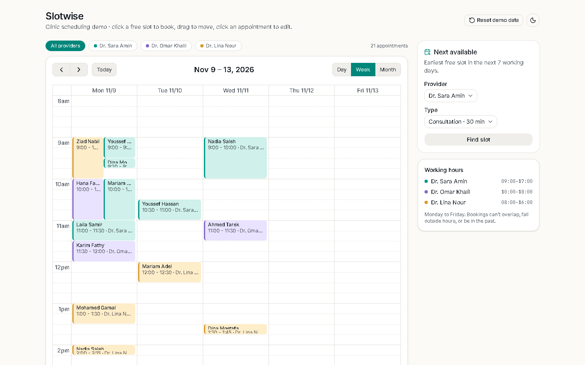

# Slotwise

A clinic appointment scheduler: book, move and resize appointments across providers, with overlap and working-hours checks and a next-free-slot finder.

[](https://github.com/Mostafa3ta/slotwise/actions/workflows/ci.yml)

**Live demo:** [slotwise-d21.pages.dev](https://slotwise-d21.pages.dev)



## Features

- **Week, day and month views** with working-hours shading, a now indicator, and a day view by default on phones
- **Three providers**, each with their own hours and colour; filter the calendar by provider
- **Book by clicking a free slot**, edit by clicking an appointment, delete from the dialog
- **Drag to move, drag to resize**, with the same rules as the form
- **Rules that can't be bypassed:** no overlaps per provider, nothing outside working hours, nothing in the past; every rejection says why
- **Next available slot:** pick a provider and an appointment type, get the earliest free slot in the next seven working days, book it in one click
- **Persists in the browser** (localStorage) with a one-click reset to fresh demo data
- **Light and dark themes**, keyboard-accessible dialog and controls, reduced-motion safe

## Stack

Next.js 15 (App Router) · React 19 · TypeScript · Tailwind CSS 4 · shadcn/ui (Radix) · FullCalendar · React Hook Form + Zod · date-fns · Vitest + React Testing Library · Playwright · GitHub Actions · Cloudflare Pages

## Key decisions

**All scheduling rules are pure functions.** `lib/scheduling.ts` has no React and no storage: `overlaps`, `isWithinWorkingHours`, `validateBooking` and `findNextAvailable` take plain data and return plain results. That's why they have 19 unit tests that run in milliseconds, and why the booking form, the drag handler and the slot finder all enforce exactly the same rules. The trade-off is a little plumbing in the `Scheduler` component to pass data in.

**FullCalendar, wrapped once and loaded late.** Building a draggable, resizable multi-view calendar from scratch is weeks of work for no interview value, so the demo uses FullCalendar. It's wrapped in a single `AppointmentCalendar` component that exposes four callbacks (`onSelectSlot`, `onSelectAppointment`, `onMove`, plus a provider filter); nothing else imports FullCalendar, so it could be swapped. It's also the heaviest dependency, so it's loaded with `next/dynamic` behind a skeleton: the page shell, filters and slot finder paint first, then the calendar.

**Concurrent appointments side by side, not stacked.** FullCalendar's default stacks overlapping events, which hides one provider's booking behind another's in the "all providers" view and even blocks clicks on it. An end-to-end test caught that; `slotEventOverlap={false}` fixes it.

**Demo data that is never empty.** The seed anchors to the weekday the calendar opens on (next Monday if today is a weekend), so the first screen always shows a full week, and the Playwright tests are deterministic.

## Run and test

```bash
npm install
npm run dev          # http://localhost:3000
npm test             # unit and component tests (Vitest)
npm run test:e2e     # end-to-end tests in a real browser (Playwright), desktop and mobile
npm run build        # production build
```

On a new machine, install the Playwright browser once: `npx playwright install chromium`.

## Known limits

- FullCalendar renders events and day headers as `<a>` elements without `href`, which Lighthouse's SEO audit flags as non-crawlable anchors. They're interactive controls in an app, not links, so this is accepted rather than worked around in the DOM.

## What I'd do next

- Recurring appointments and a waiting list for cancelled slots
- A real backend with optimistic updates, so two receptionists can't double-book across devices
- Patient search and history instead of free-text names
